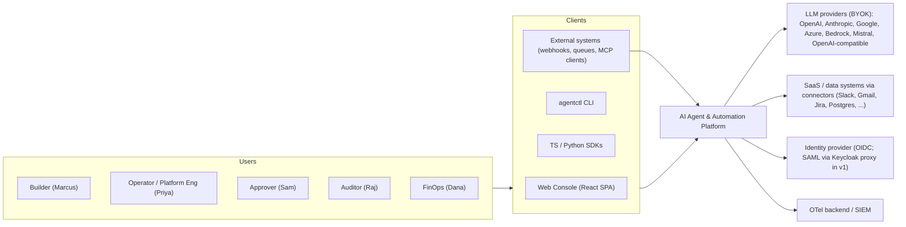
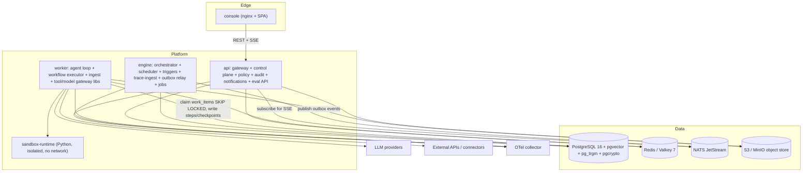
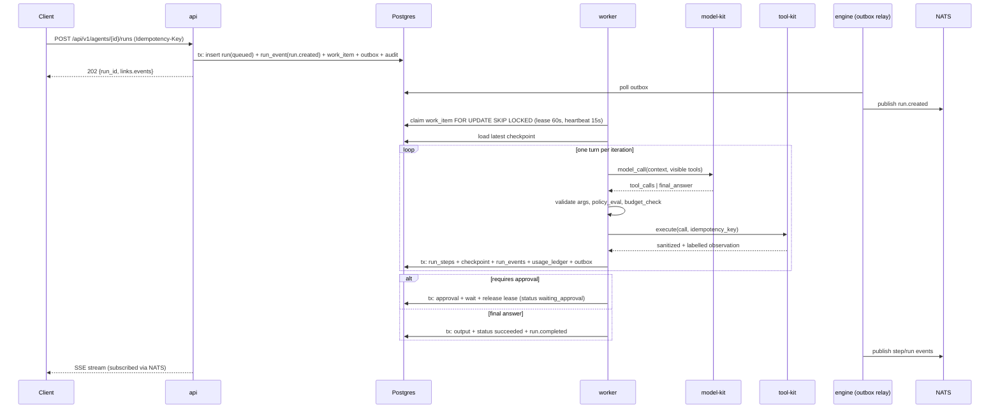
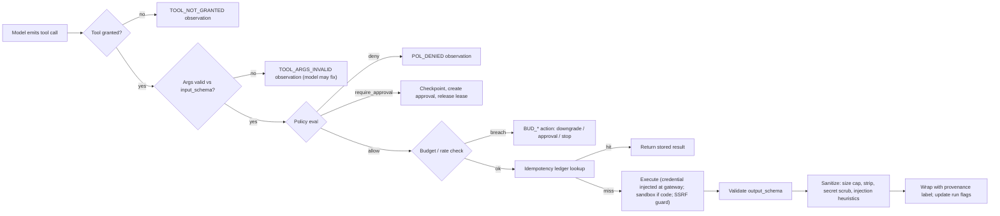
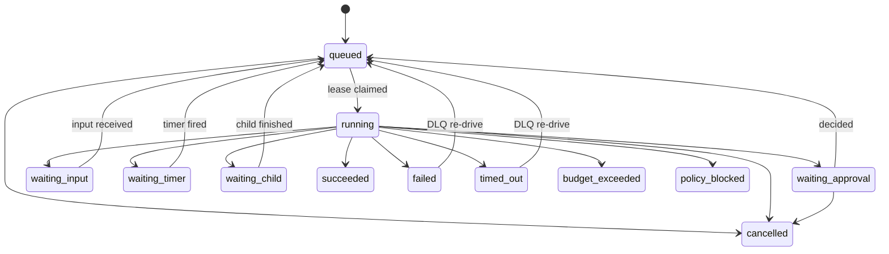

# 01 — Architecture Overview

Derived from PRD §3, §4, §5, Appendix A (A.1, A.4, A.5), Appendix C, Appendix L (D1–D25), Appendix N.

## 1. Architectural style

**Modular monolith with enforced boundaries, shipped as 4 deployables** (PRD A.1 v1 packaging). Module boundaries are mandatory even though deployment is coarse; they are enforced by `dependency-cruiser` (no cross-module imports except via published interfaces). Any module can later be split into its own service without changing its contract.

Core idea: a **Postgres-native, event-sourced durable execution core** (D4). Postgres is the source of truth for runs, work items, timers, and audit. NATS JetStream only fans out events *after* commit (transactional outbox). Redis is a cache/rate-limit layer whose loss is tolerable.

## 2. System context



## 3. Deployables (v1) and module placement

| Deployable | Modules inside (PRD A.1 service names) | Exposes | Scales by |
|---|---|---|---|
| **`apps/api`** | api-gateway, control-plane (registry, IAM, approvals, promotion, budgets), policy-service, audit-service, notification-service, eval-service (API side) | REST `/api/v1/*`, SSE, `/openapi.json`, `/health`, `/ready` | Replicas (stateless) |
| **`apps/engine`** | orchestrator (run lifecycle, lease expiry sweeper, DLQ), scheduler (cron, timers; leader-elected via advisory lock), trigger-service (webhook receiver `/hooks/*`, queue consumers, pollers), trace-ingest, outbox relay, background jobs (A.8) | `/hooks/*`, `/health` | 2–3 replicas; leader election for scheduler |
| **`apps/worker`** | worker-agent (reasoning loops), worker-workflow (graph executor), ingest-worker, tool-gateway client, sandbox dispatch, model-gateway client | none (pulls work) | Queue depth (HPA) |
| **`apps/console`** | React SPA | static assets | CDN / nginx |
| `python/sandbox-runtime` | sandbox-runner (code execution) | internal RPC | pre-warmed pool |
| `python/eval-graders` | LLM-judge & metric graders | internal RPC/queue | workers |

> **model-gateway** and **tool-gateway** are *libraries* (`packages/model-kit`, `packages/tool-kit`) used in-process by workers in v1 — they become services only when hybrid deployment (C4) requires it. Their interfaces must not assume in-process calls (no shared mutable state, all inputs serializable).

## 4. Container view



## 5. Logical components (what each owns)

| Component (PRD §5 code) | Owns | Key PRD refs |
|---|---|---|
| **API Gateway** | AuthN (OIDC/local/API keys), tenancy resolution, RBAC middleware, rate limiting, idempotency keys, error envelope, request validation | §8, B.1, O.1, O.2 |
| **Control Plane** (`GOV`) | Orgs/workspaces/projects/environments, principals, roles, agent & workflow registry + versions, tool registry & grants, connections/credentials metadata, approvals, budgets, promotions, kill switches | §5.7, B.2, M.1, M.4, N.2.13 |
| **Policy** | OPA/Rego → WASM evaluated in-process; bundle versioning; decisions logged; simulation (Phase 2) | D7, FR-GOV-4..9 |
| **Audit** | Append-only hash-chained `audit_events`, verify endpoint, export | FR-GOV-17/18, M.6 hash formula |
| **Orchestration Core** (`ORC`) | `ExecutionEngine`: runs, events, checkpoints, work items, leases, timers, retries, DLQ, cancellation, replay | §5.5, A.4, N.1, N.2.1, N.2.7–N.2.9 |
| **Agent Runtime** (`RT`) | Run manager, reasoning engines (ReAct first), context builder, limit enforcer, guardrail pipeline, supervisor | §5.1, N.2.2–N.2.4, N.2.12, N.4, N.6 |
| **Workflow Engine** (`WF`) | Graph schema/validator, item model, executor, node handlers, JSONata sandbox, triggers | §5.2, M.2, N.3, N.5 |
| **Tool Framework** (`TL`) | Tool contract, registry, validation pipeline, sanitization/labelling, built-ins, MCP client, OpenAPI import, idempotency ledger | §5.3, N.2.5, N.2.8 |
| **Model Gateway** (`MG`) | Provider adapters, capability registry + prices, tier→model mapping, routing, fallback, circuit breakers, caching | §5.9, D15, D24, N.2.6 |
| **Memory** (`MEM`) | Memory interface + pgvector backend, session memory/rolling summary, hybrid retrieval, KB ingestion & chunking | §5.4, N.2.10, N.2.11 |
| **Observability & Eval** (`OBS`/`EV`) | Traces (OTel GenAI conventions), usage ledger, metrics, datasets, graders, experiments, release gates | §5.6, N.2.6 |
| **Integration** (`INT`) | Connector SDK, connections, OAuth, credential vault, egress controls | §5.8, D.2, D17 |
| **Notifications** | Email, Slack, Teams, webhooks (signed), delivery tracking | §7.6, B.4 |

## 6. Tenancy model

```
Organization ── Workspace (billing/budget unit) ── Project ── Environment (dev | staging | prod)
```

- Every tenant table carries `org_id` (+ `workspace_id` where applicable). RLS `USING (org_id = current_setting('app.org_id', true)::uuid)` with `FORCE ROW LEVEL SECURITY`.
- **Every DB transaction** issued on behalf of a tenant runs `SET LOCAL app.org_id = $1` (and `app.workspace_id`, `app.principal_id`) inside the transaction. `SET LOCAL` (not `SET`) is mandatory so it is safe behind PgBouncer transaction pooling.
- The application DB role is **not a superuser and not `BYPASSRLS`**. Migrations run as a separate owner role. Platform-internal jobs that must cross tenants (partition manager, lease sweeper) use a dedicated `platform_system` role with narrowly granted tables — never the app role.
- Workspace/project scoping inside an org is enforced in the service layer + RBAC (RLS covers org isolation).
- Environments own their own credentials, budgets, policies; promotion copies a versioned definition, never credentials.

## 7. Key runtime flows

### 7.1 Agent run execution (PRD A.4, N.2.1, N.2.2)



### 7.2 Tool call validation pipeline (FR-TL-4, N.2.5)



### 7.3 Run state machine (PRD N.1 — exact)



Implement as a pure transition table in `packages/domain` with exhaustive tests; illegal transitions → `RES_CONFLICT`.

## 8. Event & messaging architecture

- **Transactional outbox**: every state change writes `run_events` (source of truth for replay) **and** an `outbox` row in the same transaction. The engine's outbox relay publishes to NATS and marks rows sent. Consumers are idempotent by event `id`.
- Envelope: **CloudEvents 1.0** (PRD M.5) with `orgid`, `workspaceid`, `traceparent`.
- Event types: PRD **O.5** catalogue (`run.created`, `run.step.completed`, `tool.called`, `policy.decision`, …). Subject naming on NATS: `platform.<orgid>.<type>`.
- SSE: api subscribes to NATS per request (filtered by org + run), supports `Last-Event-ID` resume by replaying from `run_events.seq`.

## 9. Security architecture (layers)

| Layer | Control | PRD |
|---|---|---|
| 1 Identity | OIDC+PKCE, local Argon2id (Compose only), API keys hashed with pepper, service accounts, **agent identities** (principals of type `agent`) | F.1, D14 |
| 2 RBAC | `resource:action` permissions, 7 default roles, scope = org/workspace/project/resource; every endpoint declares its permission; generated authz matrix test | O.1, F.2 |
| 3 Runtime policy | OPA/Rego WASM at tool call, data access, memory op, model selection, egress, promotion | D7, FR-GOV-4 |
| 4 Data | RLS, classification labels, redaction, payload capture mode (`redacted` default) | §10, FR-OBS-3 |
| Secrets | Envelope encryption (master key/KMS); injected only at tool gateway; never in context | D13, FR-INT-3 |
| Untrusted content | Provenance labels, `ingested_untrusted_content` flag, lethal-trifecta flag | FR-TL-5, N.2.5 |
| Network | SSRF guard always on; egress allowlists; sandbox no-network | N.5, F.4 |
| Audit | Hash chain, gap-free seq per org (advisory lock), REVOKE UPDATE/DELETE | M.6 |
| Kill switches | per agent/tool/connection/workspace/global; effective ≤ 5 s | C.8, E0.6-3 |

## 10. Deployment topology for v1 (Compose — target of S0.1)

| Service | Image | Port (host) | Notes |
|---|---|---|---|
| `postgres` | `pgvector/pgvector:pg16` | 5432 | extensions: vector, pg_trgm, pgcrypto, citext |
| `redis` | `valkey/valkey:7` | 6379 | |
| `nats` | `nats:2` with `-js` | 4222 / 8222 | JetStream enabled |
| `minio` | `minio/minio` | 9000 / 9001 | bucket created by init job |
| `migrate` | api image, one-shot | — | runs migrations as owner role, then exits |
| `api` | `apps/api` | 8080 | waits for migrate |
| `engine` | `apps/engine` | 8081 | `/hooks/*` |
| `worker` | `apps/worker` | — | |
| `console` | `apps/console` (nginx) | 3000 | proxies `/api` → api |
| `otel-collector` (optional profile) | `otel/opentelemetry-collector` | 4317 | `--profile observability` |
| `ollama` (optional profile) | `ollama/ollama` | 11434 | `--profile local-models` |

Production: Helm chart per PRD C.2 (namespaces `platform-system`, `platform-workers`, `platform-sandbox`, …) — Phase 0 S0.6 / later; not part of S0.1.

## 11. Quality attributes to design for from day one

| NFR | Target | Design consequence |
|---|---|---|
| NFR-2 | Step overhead P95 < 500 ms | Batch inserts per turn in one tx; payloads > 64 KB to object storage by ref; in-process LRU for published definitions |
| NFR-6 | Zero lost runs / zero duplicate effects | Leases + checkpoints + idempotency ledger; chaos tests from S0.2 |
| NFR-11 | 100% traces, ingest lag < 5 s | Trace writes buffered, never block the run (FR-OBS-* acceptance) |
| NFR-4/10 | Tenant isolation, server-side authz | RLS + authz matrix test in CI from S0.1 |
| NFR-16 | Zero-downtime upgrades | Expand-contract migrations; `engine_version` on runs; workers support N-1 checkpoint formats |
