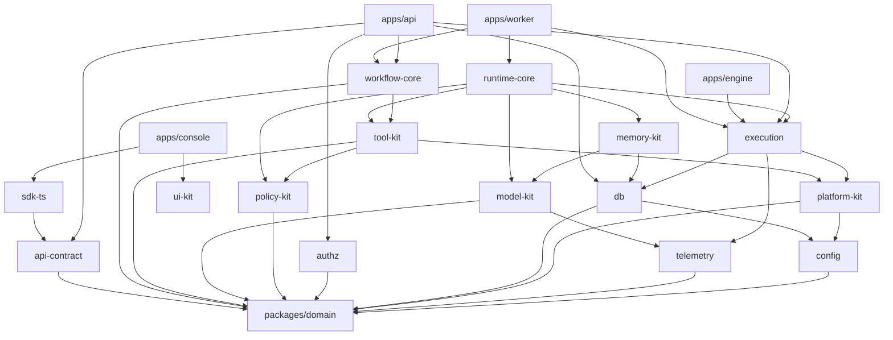

# 02 — Repository Structure and Module Boundaries

Based on PRD Appendix A.2, extended where the PRD left gaps (marked **[added]** with justification).

## 1. Top-level tree

```
/                                   # pnpm workspace root
├─ apps/
│  ├─ api/                          # gateway + control plane + policy + audit + notifications + eval API
│  ├─ engine/                       # orchestrator, scheduler, triggers (/hooks), outbox relay, trace-ingest, jobs
│  ├─ worker/                       # agent + workflow + ingest workers
│  ├─ console/                      # React SPA (Vite)
│  └─ cli/                          # agentctl (Phase 1 / S1.7; skeleton only before)
├─ packages/
│  ├─ domain/                       # entities, zod schemas, IDs, money, errors, state machines — imports NOTHING internal
│  ├─ config/          [added]      # typed env/config loader (PLATFORM_* vars), fail-fast validation
│  ├─ db/              [added]      # pg pool, Kysely instance, withTenantTx(), migrations/, partition helpers
│  ├─ execution/       [added]      # ExecutionEngine interface + Postgres implementation (runs, events, work_items, leases, timers, outbox)
│  ├─ platform-kit/    [added]      # EventBus (NATS), ObjectStore (S3), SecretsProvider, Cache (Redis), Clock, IdGen adapters
│  ├─ telemetry/                    # OTel setup, span helpers, metrics, pino logger, redaction
│  ├─ authz/           [added]      # permission catalogue (O.1), role matrix, check(), SoD rules
│  ├─ policy-kit/                   # Rego bundle loader, WASM evaluator, decision logging, simulator (P2)
│  ├─ runtime-core/                 # reasoning loops, context builder, limits, loop detection, guardrails, prompts/*.md
│  ├─ tool-kit/                     # tool contract, registry client, validation pipeline, sanitizers, SSRF guard, built-ins
│  ├─ model-kit/                    # provider adapters, capability registry, tier mapping, routing, fallback, cost calc
│  ├─ memory-kit/                   # MemoryBackend interface, pgvector adapter, retrieval scoring, chunkers
│  ├─ workflow-core/   [added]      # graph schema validator, item model, node registry, executor, JSONata sandbox
│  ├─ connector-sdk/                # declarative connector framework
│  ├─ connectors/<name>/            # one package per connector (S1.6)
│  ├─ api-contract/    [added]      # OpenAPI registry built from domain zod schemas; emits openapi.json
│  ├─ sdk-ts/                       # generated TS client
│  ├─ ui-kit/                       # design tokens, Radix-based components, status/badge system
│  └─ testing/                      # mock model server, mock tools, fixtures, test tenants, fake clock
├─ python/
│  ├─ sandbox-runtime/              # code runner (S0.3)
│  ├─ eval-graders/                 # LLM judge & metric graders (S1.3)
│  └─ sdk-py/          [moved]      # generated Python client (PRD put it under packages/; Python tooling lives here)
├─ deploy/
│  ├─ docker-compose/               # compose.yaml, .env.example, init scripts
│  ├─ docker/                       # Dockerfiles per app (multi-stage, non-root)
│  ├─ helm/                         # (S0.6+)
│  ├─ terraform/                    # (Phase 2)
│  └─ scripts/                      # bootstrap, backup/restore, seed
├─ docs/
│  ├─ adr/                          # NNNN-title.md
│  ├─ architecture/  plan/  runbooks/  guides/  api/
├─ tests/
│  ├─ e2e/  chaos/  load/  security/  contracts/
├─ .github/workflows/               # CI
├─ package.json  pnpm-workspace.yaml  turbo.json  tsconfig.base.json
├─ .dependency-cruiser.cjs  eslint.config.js  .prettierrc
└─ README.md
```

**Why the additions:** the PRD's A.2 tree has no home for (a) DB access + migrations, (b) the durable execution engine which is shared by `engine` *and* `worker` (apps may not import apps), (c) the workflow executor (shared by worker and api's validation endpoint), (d) authz catalogue (shared by api and worker for agent identities), (e) OpenAPI assembly. Without these, code would be duplicated or rules broken.

## 2. Dependency rules (enforced by dependency-cruiser in CI)



Hard rules (PRD L.3 + additions):
1. `packages/domain` imports nothing internal and has no I/O (no `pg`, no `fetch`, no `process.env`).
2. **Apps never import other apps.**
3. `apps/console` imports only `ui-kit`, `sdk-ts`, and `domain` (types/schemas). Never `db`, `execution`, etc.
4. Packages import other packages only through their `index.ts` public entry (`exports` field in package.json); deep imports are lint errors.
5. No circular dependencies.
6. Only `db` and `execution` may import `pg`/`kysely`. Only `platform-kit` may import NATS/S3/Redis clients. Only `model-kit` may import provider SDKs. Only `telemetry` may import OTel SDK packages.

## 3. Internal layout of a backend app module

Each bounded module inside `apps/api/src/modules/<module>/`:

```
modules/agents/
├─ agents.routes.ts        # HTTP routes: declare permission, schema, idempotency per route
├─ agents.service.ts       # use-cases; emits audit + events; calls policy where required
├─ agents.repo.ts          # SQL via Kysely, always inside withTenantTx
├─ agents.schemas.ts       # request/response zod (re-exports from domain where shared)
├─ agents.permissions.ts   # route → permission mapping (feeds authz matrix test)
├─ index.ts                # public surface of the module (what other modules may call)
└─ *.test.ts               # beside source (L.3)
```

Modules in `apps/api` (created only when their slice arrives): `meta`, `auth`, `tenancy` (orgs/workspaces/projects/environments), `iam` (principals, roles, bindings, api keys), `audit` (S0.1); `runs` (S0.2); `agents`, `tools`, `models` (S0.3); `workflows`, `triggers` (S0.4); `memory`, `kb` (S0.5); `secrets`, `budgets`, `killswitch` (S0.6); `approvals`, `notifications` (S1.1); `policies` (S1.2); `evals` (S1.3); `connections` (S1.6); `promotions` (S1.7); `webhooks`.

Cross-module calls go through the other module's `index.ts`, never its repo.

## 4. Console structure (`apps/console`)

```
apps/console/src/
├─ app/                    # router, providers (QueryClient, theme, auth), shell layout
├─ routes/                 # file/route-based pages (one folder per sitemap area, PRD §7.2)
│  ├─ home/ agents/ workflows/ tools/ knowledge/ runs/ approvals/ evals/ monitoring/ governance/ settings/
├─ features/               # feature slices: hooks + components per domain (runs, agents, ...)
├─ shell/                  # TopBar, LeftNav, EnvSwitcher, WorkspaceSwitcher, CommandPalette, RightDrawer, BottomDrawer
├─ api/                    # generated query hooks (from OpenAPI), SSE client
├─ state/                  # Zustand stores (UI state only)
├─ i18n/                   # ICU messages (en first), pseudo-locale
└─ test/                   # Testing Library setup, axe helpers
```

Rules: URL is source of truth for filters, tabs, selected run, **environment** (`/w/:workspace/e/:env/...`). Every page implements Loading / Empty / Partial / Error / Forbidden / Offline / Stale / Prod-safety states (PRD P.8). No default exports except pages.

## 5. Naming (PRD L.4)

- DB: `snake_case`, plural tables, `*_id`, `*_at`, `*_ref`, `*_hash`.
- API paths kebab-case; **JSON fields `snake_case`**; TS SDK maps to camelCase.
- Events: `domain.entity.verb` per O.5 catalogue.
- Metrics: `platform_<area>_<name>_<unit>`.
- Feature flags: `ff.<area>.<name>`. Env vars: `PLATFORM_<AREA>_<NAME>`.
- External IDs: prefixes per D21 (`agt_`, `agv_`, `wf_`, `run_`, `stp_`, `apr_`, …) — add `org_`, `ws_`, `prj_`, `env_`, `prn_`, `evt_`, `req_` (used in PRD examples but missing from D21; see DOC-Q-012).
