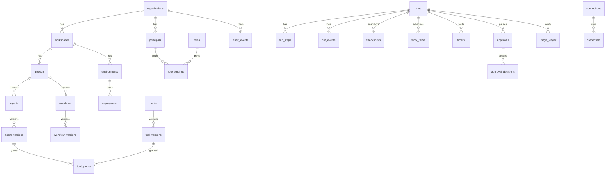

# 04 — Core Interfaces and Data Model

Write these **interfaces + contract tests first** (PRD §16 working method). Signatures are design intent in TypeScript; adjust names during implementation but keep semantics. Each interface lives in the package shown and has an in-memory/fake implementation in `packages/testing` for unit tests.

## 1. Shared primitives (`packages/domain`)

```ts
// ids.ts — UUIDv7 internally; prefixed externally (D21)
export type Brand<T, B extends string> = T & { readonly __brand: B };
export type OrgId = Brand<string, 'OrgId'>;            // uuid
export type RunId = Brand<string, 'RunId'>;
// ... one per entity
export const ExternalPrefix = { org: 'org_', workspace: 'ws_', project: 'prj_', environment: 'env_',
  principal: 'prn_', agent: 'agt_', agentVersion: 'agv_', workflow: 'wf_', workflowVersion: 'wfv_',
  run: 'run_', step: 'stp_', approval: 'apr_', tool: 'tool_', toolVersion: 'tlv_', connection: 'conn_',
  memory: 'mem_', kb: 'kb_', policy: 'pol_', budget: 'bud_', dataset: 'ds_', testCase: 'tc_',
  experiment: 'exp_', audit: 'aud_', webhook: 'whk_', apiKey: 'key_', event: 'evt_', request: 'req_' } as const;
// toExternal(prefix, uuid) / fromExternal(prefix, str): encode uuid compactly (e.g. base32 Crockford) — decide in ADR

// money.ts — D22
export type MicroUsd = Brand<bigint, 'MicroUsd'>;      // 1 USD = 1_000_000; serialize as integer JSON number or string (see DOC-Q-006)

// context.ts
export interface PrincipalRef { id: string; type: 'user' | 'group' | 'service_account' | 'agent' }
export interface TenantContext {
  orgId: OrgId; workspaceId?: WorkspaceId; projectId?: ProjectId; environmentId?: EnvironmentId;
  principal: PrincipalRef; onBehalfOf?: PrincipalRef;
  requestId: string; traceId: string;
}

// errors.ts — codes from PRD O.2 (complete list), failure classes from §4
export type FailureClass = 'transient' | 'permanent' | 'policy_violation' | 'budget' | 'model_refusal'
  | 'tool_contract_violation' | 'human_rejected' | 'timeout';
export class PlatformError extends Error { constructor(
  readonly code: ErrorCode, message: string, readonly details?: Record<string, unknown>) { super(message); } }
// ERROR_META[code] = { http, retryable, failureClass }

// state machines — PRD N.1 (run, approval, agent version, deployment, work item)
export const RUN_TRANSITIONS: Record<RunStatus, readonly RunStatus[]>;
export function assertTransition(from: RunStatus, to: RunStatus): void; // throws RES_CONFLICT

// infra-free ports
export interface Clock { now(): Date }
export interface IdGen { uuidv7(): string }
```

## 2. Infrastructure ports (`packages/platform-kit`)

```ts
export interface EventBus {                       // NATS JetStream impl; in-memory fake
  publish(evt: CloudEvent): Promise<void>;        // called only by outbox relay
  subscribe(filter: { orgId: string; types?: string[]; subject?: string },
            handler: (evt: CloudEvent) => Promise<void>): Promise<Unsubscribe>;
}
export interface ObjectStore {                    // S3/MinIO; refs look like blob://<bucket>/<org>/<key>
  put(ctx: TenantContext, key: string, body: Uint8Array | Readable, meta?: Record<string,string>): Promise<BlobRef>;
  get(ctx: TenantContext, ref: BlobRef, range?: { start: number; end: number }): Promise<Readable>;
  delete(ctx: TenantContext, ref: BlobRef): Promise<void>;
  presignPut(ctx: TenantContext, key: string, ttlMs: number): Promise<string>;
}
export interface SecretsProvider {                // D13: 'db' (envelope) | 'vault' | 'aws' | 'gcp' | 'azure'
  put(ctx: TenantContext, value: Uint8Array, meta: SecretMeta): Promise<SecretRef>;   // write-only from API
  resolve(ctx: TenantContext, ref: SecretRef, purpose: 'tool_call' | 'provider_call' | 'webhook_sign'): Promise<Uint8Array>; // audited
  rotate(ctx: TenantContext, ref: SecretRef, value: Uint8Array): Promise<SecretRef>;
  delete(ctx: TenantContext, ref: SecretRef): Promise<void>;
}
export interface Cache { get/set/del/incrWindow(...) }      // Redis; loss must be tolerable
```

## 3. Database access (`packages/db`)

```ts
export function withTenantTx<T>(ctx: TenantContext, fn: (tx: Kysely<DB>) => Promise<T>,
  opts?: { isolation?: 'read committed' | 'repeatable read' | 'serializable' }): Promise<T>;
// BEGIN; SET LOCAL app.org_id=..; SET LOCAL app.workspace_id=..; SET LOCAL app.principal_id=..; fn(); COMMIT
export function withSystemTx<T>(reason: string, fn: (tx: Kysely<DB>) => Promise<T>): Promise<T>;
// uses platform_system role; every call logged; only engine jobs may import it (depcruise rule)
```

## 4. Durable execution (`packages/execution`) — D4, A.4, N.1, N.2.1

```ts
export interface ExecutionEngine {
  createRun(ctx: TenantContext, req: CreateRunRequest): Promise<RunRecord>;      // run(queued)+run.created+work_item+outbox+audit, one tx
  claim(workerId: string, queues: string[], max: number): Promise<Lease[]>;      // weighted-fair, SKIP LOCKED, serialize_key aware
  heartbeat(lease: Lease): Promise<boolean>;                                      // false => abort execution immediately
  loadState(lease: Lease): Promise<CheckpointState | null>;
  commitTurn(lease: Lease, turn: TurnCommit): Promise<void>;                      // steps + checkpoint + run_events + usage + outbox, ONE tx
  suspend(lease: Lease, wait: WaitCondition): Promise<void>;                      // waiting_*; releases lease; creates timer/approval refs
  complete(lease: Lease, outcome: RunOutcome): Promise<void>;                     // terminal status + termination_reason + run.completed
  retryLater(lease: Lease, err: PlatformError, delayMs: number): Promise<void>;
  fail(lease: Lease, err: PlatformError): Promise<void>;                          // DLQ when attempts exhausted
  signal(ctx: TenantContext, runId: RunId, s: RunSignal): Promise<void>;          // approval decided / input / child done -> re-enqueue (+1 priority)
  cancel(ctx: TenantContext, runId: RunId, reason: string): Promise<void>;        // cooperative; propagates to children
  redrive(ctx: TenantContext, runIds: RunId[], inputPatch?: unknown): Promise<void>;
}
export interface TimerService { schedule(t: TimerSpec): Promise<void>; fireDue(now: Date, batch: number): Promise<number> }
export interface LeaseSweeper { requeueExpired(now: Date): Promise<number> }    // engine job
export interface OutboxRelay { drain(batch: number): Promise<number> }           // engine job -> EventBus
```

Contract tests (run against Postgres via Testcontainers): exactly-once processing of 1,000 items by 10 workers with random kills (E0.2-2); lease expiry → resume from last checkpoint; illegal transitions rejected; timer fires ≤ 1 s after due across restart (E0.2-3).

## 5. Agent runtime (`packages/runtime-core`)

```ts
export interface ReasoningStrategy {              // FR-RT-6: init / next_action / on_observation / should_stop
  readonly pattern: 'react' | 'plan_execute' | 'reflexion' | 'deterministic' | 'custom';
  init(input: unknown, def: AgentDefinition): AgentState;
  nextAction(state: AgentState, deps: TurnDeps): Promise<NextAction>;  // model call -> tool_calls | final | escalate
  onObservation(state: AgentState, obs: Observation[]): AgentState;
  shouldStop(state: AgentState): StopDecision | null;
}
export interface ContextBuilder { build(state: AgentState, budget: TokenBudget): Promise<BuiltContext> } // N.2.3; logs truncations
export interface LimitEnforcer { check(state: AgentState, projected?: Usage): LimitViolation | null }    // FR-RT-1, termination reasons
export interface LoopDetector { observe(call: ToolCall, obs: Observation): LoopSignal | null }          // N.2.4
export interface GuardrailPipeline { input(...); output(...); toolArgs(...) }                             // N.6 order
export function runTurn(state: AgentState, deps: TurnDeps): Promise<TurnResult>;                        // N.2.2, pure orchestration over ports
```

## 6. Model gateway (`packages/model-kit`) — §5.9

```ts
export interface ModelProvider {                  // one adapter per provider; contract-tested against recorded fixtures
  readonly id: 'openai' | 'anthropic' | 'google' | 'azure_openai' | 'bedrock' | 'mistral' | 'openai_compatible';
  chat(req: CanonicalChatRequest, signal: AbortSignal): AsyncIterable<CanonicalChatChunk>;  // streaming, tool calls, structured output
  embed(req: EmbedRequest): Promise<EmbedResponse>;
  normalizeError(e: unknown): PlatformError;      // MODEL_RATE_LIMIT | MODEL_OVERLOADED | MODEL_REFUSAL | ...
}
export interface CapabilityRegistry { get(model: string): ModelCapabilities /* ctx window, tools, json, modalities, prices per Mtok, regions */ }
export interface ModelRouter { resolve(tier: Tier | { model: string }, features: RoutingFeatures, ws: WorkspaceModelMap): ModelChoice[] } // primary + fallbacks
export function costMicroUsd(usage: Usage, price: PriceSnapshot): MicroUsd;  // N.2.6, ceil
```
Messages use the **canonical provider-neutral format** (M.3): `{role, content: [{type: text|tool_call|tool_result|image, ...}], meta}`.

## 7. Tools (`packages/tool-kit`) — §5.3, N.2.5, N.2.8

```ts
export interface ToolContract { name; version; description; input_schema; output_schema;
  side_effect_class: 'read' | 'write' | 'destructive' | 'external_comms'; idempotent: boolean;
  required_permissions: string[]; data_classification_touched: string[]; timeout_ms: number;
  retry_policy; rate_limit?; cost_model?; examples?; implementation: { type: 'mcp'|'http'|'code'|'workflow'|'builtin'; ... };
  parallel_safe?: boolean; dry_run_supported?: boolean; compensation_tool?: string }
export interface ToolExecutor { execute(call: ResolvedToolCall, opts: { idempotencyKey: string; dryRun: boolean; signal: AbortSignal }): Promise<RawToolResult> }
export interface ToolGateway {                    // the full FR-TL-4 pipeline
  invoke(ctx: RunToolContext, call: ToolCall): Promise<Observation | ApprovalRequired | PolicyDenied>;
}
export interface Sanitizer { sanitize(r: RawToolResult, contract: ToolContract): Observation }  // size cap, strip, secret scrub, injection flag, provenance wrap
export interface SsrfGuard { assertAllowed(url: URL, allowlist?: string[]): Promise<ResolvedTarget> } // resolve DNS, block private ranges, re-check redirects
export interface EffectLedger { lookup(key: string): Promise<StoredResult | null>; record(key: string, r: StoredResult): Promise<void> } // 7 d
```

## 8. Policy & authz

```ts
// packages/authz — static RBAC (O.1)
export const PERMISSIONS = [...] as const;                     // generated from O.1 table
export const DEFAULT_ROLE_MATRIX: Record<Role, PermissionGrant[]>;
export function authorize(p: PrincipalWithBindings, perm: Permission, scope: Scope, resource?: ResourceOwnership): AuthzDecision;
export function assertSeparationOfDuties(action: SodAction, actor: PrincipalRef, subject: SodSubject): void; // not configurable off in prod

// packages/policy-kit — runtime policy (D7)
export interface PolicyEvaluator {
  evaluate(point: 'tool_call'|'data_access'|'memory_read'|'memory_write'|'model_select'|'egress'|'promotion'|'publish',
           input: PolicyInput): Promise<PolicyDecision>; // {effect, policy_ids, explanation, obligations}
}
// v1 default bundle = allow-all + built-in rules (autonomy level, side-effect class approvals, untrusted-context deny for external_comms)
```

## 9. Memory (`packages/memory-kit`) — FR-MEM-8

```ts
export interface MemoryBackend {
  put(ctx, item: NewMemoryItem): Promise<MemoryItem>;
  get(ctx, id): Promise<MemoryItem | null>;
  search(ctx, q: MemoryQuery): Promise<ScoredMemoryItem[]>;   // N.2.10 scoring; scope + sensitivity filtered before ranking
  delete(ctx, id, opts: { hard: boolean }): Promise<void>;
  list(ctx, filter, cursor?): Promise<Page<MemoryItem>>;
  export(ctx, filter): AsyncIterable<MemoryItem>;
  eraseSubject(ctx, subjectId): Promise<ErasureReport>;        // FR-MEM-5, audited
}
```

## 10. Workflow (`packages/workflow-core`) — M.2, N.5

```ts
export interface NodeHandler<C = unknown> {
  readonly type: string;                              // e.g. 'logic.switch'
  readonly configSchema: ZodType<C>;                  // also emitted as JSON Schema for the inspector form
  readonly ports: { inputs: string[]; outputs: string[] };
  execute(input: Item[], config: C, ctx: NodeContext): Promise<NodeResult>; // NodeResult = items per output port | wait | error
}
export function validateGraph(g: WorkflowGraph, registry: NodeRegistry): GraphValidationResult; // FR-WF-1 rules
export interface ExpressionEngine { evaluate(expr: string, scope: ExprScope, limits: { timeoutMs: 50; maxBytes: 1_048_576 }): Promise<unknown> } // JSONata
```

## 11. Data model

### 11.1 Core ERD (v1 scope)



### 11.2 Schema completion list (PRD M.6 DDL is partial)

M.6 provides exact DDL for: `organizations`, `workspaces`, `environments`, `principals`, `agents`, `agent_versions`, `deployments`, `runs`, `run_events`, `run_steps`, `checkpoints`, `work_items`, `timers`, `approvals`, `approval_decisions`, `memory_items`, `usage_ledger`, `audit_events`, `idempotency_keys`.

**Missing but required — author following A.3 principles** (`id uuid` v7, `org_id`, `workspace_id` where applicable, `created_at/updated_at`, `deleted_at` soft delete except audit, RLS FORCE):

| Table | Needed in slice | Notes |
|---|---|---|
| `projects` | **S0.1** | `agents.project_id` references it but it is not defined in M.6 (DOC-Q-001) |
| `roles`, `role_bindings` | **S0.1** | System roles seeded from O.1; `scope_type`, `scope_id` |
| `users_local` (or `local_credentials`) | **S0.1** | Argon2id hash for Compose mode; FK to principals |
| `sessions`, `api_keys` | **S0.1** | Hashed keys (prefix visible), scopes, `last_used_at`, revoked |
| `outbox` | **S0.1** (used from S0.2) | `id, org_id, topic/type, payload, created_at, published_at`; A.4 mandates outbox but no table given (DOC-Q-002) |
| `feature_flags`, `settings` | S0.1 | Per-scope overrides |
| `dlq_entries` (or view over `work_items` status=`dead`) | S0.2 | FR-ORC-7 |
| `workflows`, `workflow_versions`, `triggers`, `trigger_events` | S0.4 | M.2 graph JSONB + `schema_version` |
| `tools`, `tool_versions`, `tool_grants`, `effect_ledger` | S0.3 | contract JSONB; grant scope JSONB; ledger 7 d |
| `model_providers`, `workspace_model_map`, `provider_keys` | S0.3 | Keys via SecretsProvider refs only |
| `sessions_conversation` (chat sessions) | S0.5 | Distinct from auth sessions — name carefully |
| `kb_sources`, `kb_documents`, `kb_chunks` | S0.5 | Chunk embedding + content_hash |
| `secrets` (db provider envelope store) | S0.6 | `ciphertext, dek_wrapped, key_version` |
| `budgets`, `killswitches` | S0.6 | |
| `policies`, `policy_versions`, `policy_decisions` | S1.2 | Partition decisions |
| `datasets`, `test_cases`, `experiments`, `experiment_results`, `graders` | S1.3 | |
| `connections`, `credentials`, `connection_env_map` | S1.6 | `secret_ref` only |
| `promotions` | S1.7 | |
| `webhooks`, `webhook_deliveries`, `notifications` | S1.1 | |

### 11.3 DDL caveats the developer must handle

1. **Partitioned tables** (`runs`, `run_events`, `run_steps`, `usage_ledger`, `audit_events`) have composite PKs including the partition key; Postgres cannot FK *to* them by `id` alone. Use application-level integrity (or FK on `(id, created_at)`); document in ADR.
2. **Partition manager** must create the current month + next 3 at migration time (E0.2-1), otherwise inserts fail.
3. `audit_events` uses `REVOKE ... FROM PUBLIC` — also revoke from the app role explicitly and grant only `INSERT, SELECT`.
4. `principals.email citext` requires `CREATE EXTENSION citext` (missing from M.6 extensions list).
5. RLS policy shown only for `agents` — apply the same policy to **every** tenant table via a migration helper, plus a CI test that lists tables lacking RLS and fails.
6. `memory_items.embedding vector(1536)` vs configurable dimensions up to 3072 (O.3): pgvector HNSW on `vector` supports at most 2,000 dimensions — see DOC-Q-008.
