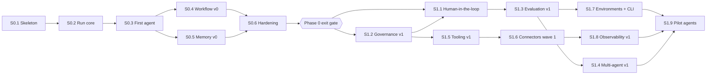

# 05 — Delivery Plan (Slices, Order, Context Packs)

Source: PRD §13 (slices), §13.1 (MoSCoW), §14 (Definition of Done), Appendix Q (backlog, estimates), Appendix S.3 (security gates).

Each slice is a **thin end-to-end feature** that runs, is traced, and is tested. One slice at a time; DoD before moving on.

## 1. Slice dependency graph



> Recommended deviation from PRD order: do **S1.2 (RBAC/audit/agent identities) before S1.1 (approvals)**, because approvals depend on roles, separation of duties, and audit. Basic audit emission already starts in S0.1.

## 2. Slice table

PRD line numbers refer to the PRD file so the developer can load only the needed context ("context pack").

| Slice | Goal | Backlog stories (Q) | Key requirement IDs | Context pack (PRD lines) | Exit criteria |
|---|---|---|---|---|---|
| **S0.1 Skeleton** | Running monorepo + Compose + tenancy + auth + gateway + console shell | E0.1-1…8 | NFR-4, NFR-10, NFR-12, NFR-15, NFR-17, FR-GOV-2 (roles), FR-GOV-17 (audit basics) | §3.5 177-188; A.2 1023-1054; A.3 1056-1090; B.1 1161-1184; C.1 1294-1303; E.1-E.3 1488-1535; L 1762-1832; M.6 1979-2124; O.1 2358-2396; O.2 2397-2452; O.4 2485-2510; P.8 2671-2683; §7.2 549-585 | See [S0.1-skeleton.md](S0.1-skeleton.md) |
| **S0.2 Run core** | Durable runs survive worker kill; trace visible | E0.2-1…8 | FR-ORC-1..8, FR-RT-1, FR-RT-14, FR-OBS-1, NFR-6, NFR-11 | §4 189-216; §5.5 386-408; A.4 1091-1122; A.5 1123-1128; M.3 1915-1950; M.5 1968-1978; N.1 2127-2155; N.2.1 2158-2176; N.2.7-N.2.8 2229-2236; O.5 2511-2537; §7.3.5 669-683 | Kill-worker test passes; 1,000 items × 10 workers exactly once; timers survive restart; run list/detail UI with live SSE |
| **S0.3 First agent** | Agent answers using tools in playground with full trace and cost | E0.3-1…9 | FR-RT-1..2, 7(L0–L3 model), 8, 9, 10, 11, 13, 14; FR-TL-4, 6 (subset), 9; FR-MG-1, 2, 3, 4; NFR-2, NFR-7 | §5.1 221-275; §5.3 312-353; §5.9 507-516; M.1 1835-1888; N.2.2-N.2.6 2178-2228; N.4 2261-2302; N.5 SSRF 2338; N.6 2340-2355; O.3 2453-2484; §7.3.3 603-657; P.1-P.2 2563-2592; P.7 2620-2641 | Playground run streams with steps, tokens, cost; limits terminate correctly; SSRF + sandbox tests pass; mock model server in CI |
| **S0.4 Workflow v0** | Webhook → agent → Slack workflow on schedule | E0.4-1…7 | FR-WF-1..5, 7, 9, 10 | §5.2 276-311; M.2 1889-1914; N.3 2257-2260; N.5 2303-2339; B.5 1272-1276; §7.3.4 658-668; E.4.2 1548-1550; P.7 2643-2656 | 50-node graph incl. 3 parallel branches + 1,000-item loop survives restart; YAML round-trip lossless |
| **S0.5 Memory v0** | Agent cites retrieved chunks | E0.5-1…4 | FR-MEM-1, 2, 3, 7 (files/URLs), 8 | §5.4 354-385; N.2.10-N.2.11 2241-2248; §7.3.8 699-703 | Recall@5 ≥ 0.8 on seeded set; re-sync only changed chunks; citation chips in UI |
| **S0.6 Hardening** | Limits, budgets, secrets, kill switch, backups, perf baseline | E0.6-1…6 | FR-GOV-14 (basic), FR-INT-3, NFR-1, NFR-2, NFR-7 | §6 517-537; C.5-C.8 1352-1403; F 1598-1644; N.2.6 2223-2228; S.3 2922-2932 | Runaway agent stopped within one step; zero secrets in logs/traces (scan); kill switch ≤ 5 s; restore drill |
| **Phase 0 gate** | | | | Q.1 footer 2766; S.3 2922-2932 | Webhook→agent→Slack on schedule 7 days, zero lost runs; chaos green; S.3 gates green; ADRs D4, D7, D8, D10 approved |
| **S1.2 Governance v1** | RBAC, agent identities, audit chain, tool grants, autonomy L0–L3 | E1.2 | FR-GOV-1, 2, 12 (SoD), 17, 18 (CSV); FR-TL-3; FR-RT-7 | §5.7 449-494; O.1 2358-2396; M.6 audit 2104-2123; F.1-F.2 1600-1611; §7.3.11 717-724 | Authz matrix from O.1 passes; tamper test detected by `/audit/verify` |
| **S1.1 Human-in-the-loop** | Approvals pause/resume; inbox; Slack/email | E1.1 | FR-GOV-12, 13; FR-ORC-4 | M.4 1951-1967; N.1 approval 2150; B.2-B.3 approvals; §7.3.6 684-691; E.4.3 1552-1554; P.3 2593-2607; D.4 Slack 1470 | 7-day pending approval survives upgrade; Slack decision resumes run < 5 s; SoD tests pass |
| **S1.3 Evaluation v1** | Datasets, graders, experiments, gates, save-as-test-case | E1.3 | FR-EV-1..4, 8 | §5.6 433-448; N.4 judge 2299; §7.3.9 704-710; H 1663-1679 | Failed run → regression test passing in < 5 min (journey test) |
| **S1.4 Multi-agent v1** | Supervisor + specialists, typed handoffs, blackboard, cost roll-up | E1.4 | FR-RT-20..24 | §5.1 261-269; M.1 delegation; §7.3.3 Team canvas 654-656 | Supervisor + 3 specialists completes benchmark; per-agent attribution in trace |
| **S1.5 Tooling v1** | OpenAPI import, MCP client, registry UI, dry-run, untrusted labelling | E1.5 | FR-TL-1 (client), 2, 5, 7, 8, 9 | §5.3 312-353; N.2.5 2214-2221; §7.3.7 692-698 | Injection corpus passes; MCP tool blocked until approved |
| **S1.6 Connectors wave 1** | Connector SDK + D17 connectors | E1.6 | FR-INT-1..6 | §5.8 495-506; D.2-D.5 1431-1485; L D17 1784; P.4 2608-2610 | Each connector passes contract tests vs recorded fixtures |
| **S1.7 Environments + CLI** | Promotion with diff/approvals, rollback, `agentctl` | E1.7 | FR-WF-8, 11; FR-EV-4 | N.2.13 2253-2255; B.7 1285-1290; §7.3.3 Versions/Deployments 642-648 | Unmapped credential blocks promotion with clear error; rollback restores behaviour |
| **S1.8 Observability v1** | Dashboards, alerts, OTel export, cost tab, failure explainer | E1.8 | FR-OBS-2..5; FR-GOV-16 | §5.6 409-432; §7.3.10 711-716; C.6 1364-1369 | Alert fires within 2 min of synthetic spike |
| **S1.9 Pilot agents** | Support Triage (L1) + Invoice Exception (L2) | E1.9 | D16 | S.1-S.2 2892-2920; S.4 2933-2943 | KPI targets met in staging; process-owner sign-off |

## 3. How to brief each slice

Use the PRD §16.1 template (copy below). [S0.1-skeleton.md](S0.1-skeleton.md) is a filled example — produce one per slice before starting it and save as `docs/plan/S<id>-<name>.md`.

```
SLICE: <ID and name>
GOAL: <one sentence outcome>
REQUIREMENTS: <FR/NFR/story IDs>
CONTEXT: <PRD line ranges + docs/architecture files>
CONSTRAINTS: <tech defaults, performance targets, security rules>
DELIVERABLES: folder structure, interfaces, implementation, tests (unit, integration, failure-injection),
              migrations, OpenAPI additions, UI with all states, docs, demo script
ACCEPTANCE: <acceptance criteria>
DON'T: <explicit exclusions>
```

After each slice run the PRD §16.2 review prompt (skeptical staff engineer + security reviewer), fix critical/high findings, then tick the DoD (PRD §14).

## 4. Scope-cut order if behind (PRD Q.4)

Defer in this order: E0.5-3 URL ingestion → E0.4-4 non-core nodes → E0.2-8 nightly chaos (keep manual) → E0.3-8 compare features.
**Never defer:** durability, tenancy tests, secrets handling, trace completeness.

## 5. ADRs required before Phase 0 exit

D4 (Postgres executor), D7 (OPA/Rego WASM), D8 (JSONata), D10 (Postgres traces) — plus the S0.1 tooling ADRs listed in [03-tech-stack §2](../architecture/03-tech-stack-and-conventions.md). Index: [../adr/README.md](../adr/README.md).
